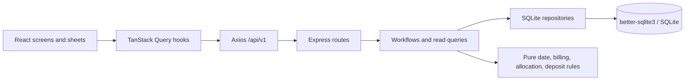

# Verified System Architecture

## Current architecture (verified)

The client and server are separate npm packages. Vite proxies `/api` to `http://localhost:4000` in development. Server `index.js` reads `PORT` (default 4000), initializes a local SQLite file, starts Express, and closes server/DB on SIGINT/SIGTERM. This is a local development topology; production deployment topology is not described by checked-in deployment manifests.

## Responsibility and dependency boundaries

- **Client:** `main.jsx` mounts `app/App`; providers install QueryClient and selected-property context. Screens/layouts compose UI. Data hooks use Axios and query keys. Client `workflows/` are interactive form components, not authoritative domain services.
- **HTTP layer:** `server/src/app.js` enables CORS and JSON parsing, logs method/path/status/duration, mounts routers, then 404 and error handlers. Routes map HTTP inputs to workflows/queries and wrap success in `{data:...}`.
- **Server core:** workflows orchestrate mutation use cases; query modules compose read models; repos encapsulate SQL; policies compute dates/allocation/deposit amounts.
- **Persistence:** `getDatabase` opens `server/db/stay_ledger.db`, enables foreign keys, WAL, `busy_timeout=5000`, and executes schema SQL. The non-memory DB handle is cached as a module singleton.

There is no separate `core/` package shared by client/server. The `server/src/core` directory depends directly on Node-oriented persistence and is not currently Android-portable. Some modules import the DB connection through `../../../../server/db/connection.js`, coupling core paths to the repository layout.

## Consistency, query, and error behavior

Multi-row move-in, payment collection, shift, checkout, and deposit settlement use synchronous better-sqlite3 transactions. Structure delete workflows transact around precondition+delete; structure adds are single repository writes. Query reads are not wrapped in explicit read transactions. QueryClient defaults: two-minute stale time, no refetch on focus, retry once. Axios unwraps `{data}` and normalizes error envelopes.

Error middleware maps a finite set of error codes to HTTP status; unknown errors become generic 500. There is no authentication or authorization middleware. CORS is unrestricted (`cors()` defaults), and request logging includes URL. These are current security boundaries, not guarantees for deployment.

## Actual conventions and exceptions

Production JSX generally uses `.jsx`; pure modules use `.js`; named exports are common. `client/src/App.jsx` is an unused default-export placeholder; actual entry is `main.jsx` → `app/App.jsx`. `DashboardBottomSheet.jsx` has a local stack and synchronously resolves room/bed from `floors`; nested data hooks fetch ledger only when a ledger view is open. Other screens can use their own sheets/selection state. Property selection persists in localStorage and query data is supplied to context.

## Intended Android target — not current architecture

The stated target is Android as primary app, with business core running locally and directly managing a local DB, without the current server/API runtime. Migration boundary is not yet decided. See [Android plan](06_ANDROID_MIGRATION.md) for portability gaps and open choices. Do not imply current server core is already shared or that the target storage/framework has been selected.
